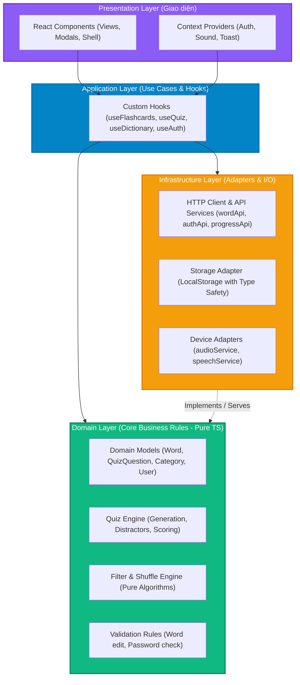

# KẾ HOẠCH TÁI CẤU TRÚC FRONTEND CLEAN ARCHITECTURE
**Dự án**: IELTS Vocab Mastery (`ielts-vocab-mastery`)  
**Tài liệu**: `strat.md`  
**Phiên bản đề xuất**: 3.0.0 Architecture Plan  
**Định hướng kiến trúc**: **Pragmatic Clean Architecture (React-Idiomatic Clean Architecture)**

---

## 1. TỔNG QUAN & ĐÁNH GIÁ HIỆN TRẠNG (AS-IS ASSESSMENT)

### 1.1. Thống kê Codebase Frontend hiện tại
Toàn bộ frontend hiện tại tập trung trong thư mục `src/components/`, `src/lib/`, và `src/app/page.tsx`:

| File / Component | Số dòng | Trách nhiệm hiện tại | Vấn đề kiến trúc (Code Smells) |
|---|---|---|---|
| `VoltVocabApp.tsx` | **587** | Root State Manager, API sync, LocalStorage, derived lists, modal triggers, layout | **God Component**: Quá tải trách nhiệm, prop drilling 10-15 props xuống các tab |
| `FlashcardTab.tsx` | **913** | 3D Flip animation, gesture swipe, keyboard listener, audio trigger, confetti, filter modal, draft state, copy clipboard | **Monolithic View**: Trộn lẫn UI, Web Audio, SpeechSynthesis, DOM events và State máy in |
| `QuizTab.tsx` | **363** | Quản lý câu hỏi, sinh distractor, chấm điểm, streak, sound, UI render 3 view | **Domain Logic Leaked into UI**: Thuật toán sinh đề quiz nằm trực tiếp trong React Component |
| `EditWordModal.tsx` | **412** | Form state, dynamic topic filtering, fetch direct `PUT /api/words`, toast trigger | **Direct I/O in Component**: Component UI gọi trực tiếp `fetch()` và tự parse lỗi HTTP |
| `DictionaryTab.tsx` | **301** | Search, POS filter, Learned filter, scroll-to-top, sound trigger, open edit modal | Phụ thuộc quá nhiều props được truyền từ cha (12 props) |
| `AuthModal.tsx` | **208** | Login/Register form, direct `fetch('/api/auth/...')`, token storage, sound | Trùng lặp logic fetch và xử lý token ở nhiều modal khác nhau |
| `ChangePasswordModal.tsx` | **222** | Password change form, direct fetch, error handling | Trùng lặp xử lý request header và parse response |
| `Header.tsx` | **299** | Dropdown Categories, Units selector, Audio toggle, User status, Account menu | View component nhưng ôm logic tính toán unit và menu state phức tạp |
| `audio.ts` | **180** | Web Audio API synthesize, SpeechSynthesis, format CSS classes (`badge-pos-*`) | **Tạp chất trách nhiệm**: Trộn Browser Hardware API với CSS/UI Presentation format |

### 1.2. 5 Vấn đề Cốt lõi Cần Giải Quyết
1. **Thiếu sự phân tầng (No Layering)**: Mã nguồn chỉ có 2 nhóm: `components` (chứa toàn bộ UI + state + logic nghiệp vụ) và `lib` (chứa db backend và audio). Không có tầng Domain độc lập hay tầng Data/Infrastructure riêng biệt.
2. **Logic nghiệp vụ bị khóa chặt trong React (React Coupling)**: Các thuật toán quan trọng như: sinh đề trắc nghiệm (distractor generator), lọc từ theo trạng thái, thuật toán xáo trộn từ (Fisher-Yates shuffle), tính toán tiến độ... đều bị gắn chặt vào `useState` và `useEffect`. Không thể viết Unit Test độc lập nếu không render component.
3. **Phân mảnh giao tiếp API (Scattered I/O Calls)**: Mỗi component tự viết `fetch('/api/...')`, tự parse JSON, tự bắt lỗi, tự quản lý headers Authorization. Thiếu một HTTP Client tập trung.
4. **Prop Drilling trầm trọng**: `VoltVocabApp` phải nắm giữ toàn bộ state và truyền qua 2-3 tầng component, gây re-render không cần thiết và khó khăn khi muốn thêm tính năng mới.
5. **Khó bảo trì & mở rộng**: Khi cần thay đổi logic quiz hay bộ lọc từ vựng, lập trình viên buộc phải can thiệp trực tiếp vào file UI dài hàng trăm dòng.

---

## 2. LỰA CHỌN PHƯƠNG ÁN KIẾN TRÚC TỐI ƯU

Khi áp dụng Clean Architecture vào Frontend, có 2 trường phái chính:

```
[Phương án 1: Strict Enterprise Clean Architecture]
Entities -> Use Cases (Classes) -> Repositories (Interfaces) -> Repository Impls -> Controllers -> Presenters -> React UI
==> ❌ KHÔNG PHÙ HỢP: Quá nặng nề, Over-engineering, sinh ra hàng chục file boilerplate thừa cho 1 app Next.js nhỏ.

[Phương án 2: Pragmatic Clean Architecture (React-Idiomatic Clean Architecture)]
Domain (Pure TS) <--- Application (Custom Hooks & Context) <--- Infrastructure (Services/Adapters) <--- Presentation (UI)
==>  LỰA CHỌN TỐI ƯU: Giữ trọn giá trị cốt lõi của Clean Architecture nhưng tối giản, gắn kết tự nhiên với React 19 / Next.js.
```

### 2.1. So sánh chi tiết

| Tiêu chí | Strict Enterprise Clean Architecture | Pragmatic Clean Architecture (Đề xuất) |
|---|---|---|
| **Số lượng tầng** | 5-6 tầng (Entities, UseCases, Repositories, DTOs, Mappers, Presenters, Views) | 4 tầng tinh gọn (Domain, Infrastructure, Application/Hooks, Presentation) |
| **Boilerplate** | Rất cao (Mỗi action cần 1 Interface, 1 Class Interactor, 1 DTO, 1 Mapper) | Cực thấp (Tận dụng Pure Functions, TypeScript Types & React Custom Hooks) |
| **Tính tương thích React**| Kém tự nhiên (phải ép DI Container như Inversify, xử lý Observable/Class) | Tự nhiên 100% (Hooks đóng vai trò Use Case, Context đóng vai trò State Provider) |
| **Khả năng Unit Test** | 100% testable | 100% testable (Domain & Services test độc lập không cần DOM/React) |
| **Chi phí bảo trì dự án nhỏ**| Quá cao, làm chậm tốc độ phát triển | Cân bằng hoàn hảo: Rõ ràng, sạch sẽ, mở rộng nhanh chóng |

### 2.2. Kết luận lựa chọn: **Pragmatic Clean Architecture**
- **Domain Core**: Giữ lại trái tim của Clean Architecture: Các thực thể (`Word`, `Category`, `UserProgress`) và quy tắc nghiệp vụ (`QuizEngine`, `FilterEngine`, `ShuffleEngine`) là các hàm TypeScript thuần túy (**Pure TypeScript**), không import React hay Next.js.
- **Application Layer**: Đóng gói các trường hợp sử dụng (Use Cases) bằng **React Custom Hooks** (`useFlashcards`, `useQuiz`, `useDictionary`, `useWordEditor`) kết hợp **Lightweight Contexts** để triệt tiêu prop drilling.
- **Infrastructure Layer**: Độc lập hóa API Client, Browser Storage và Device Hardware (Web Audio/Speech).
- **Presentation Layer**: Các component chỉ tập trung vào việc hiển thị và bắt sự kiện người dùng (Dumb/Presentational Components).

---

## 3. SƠ ĐỒ KIẾN TRÚC & QUY TẮC PHỤ THUỘC (DEPENDENCY RULE)

Theo Clean Architecture, **Quy tắc phụ thuộc (Dependency Rule)** quy định: Mã nguồn ở tầng ngoài chỉ được phép phụ thuộc vào mã nguồn ở tầng trong. Tầng trung tâm (Domain) không phụ thuộc vào bất cứ tầng nào.



### Chi tiết 4 tầng chức năng:

1. **Domain Layer (`src/domain/`)**:
   - **Đặc điểm**: Mã nguồn thuần TypeScript (`.ts`), không có JSX, không có React hook (`useState`, `useEffect`), không có `fetch` hay `window`.
   - **Nhiệm vụ**: Chứa kiểu dữ liệu thực thể (`entities/`) và thuật toán lõi (`services/`):
     - `quizEngine.ts`: Thuật toán chọn từ ngẫu nhiên, sinh 3 câu sai (distractors), hoán vị phương án, tính điểm, streak.
     - `filterEngine.ts`: Logic lọc từ vựng theo Topic, POS, trạng thái Mastered/Unmastered, thuật toán xáo trộn thẻ từ.
     - `validation.ts`: Kiểm tra hợp lệ dữ liệu từ vựng, mật khẩu.

2. **Infrastructure Layer (`src/infrastructure/`)**:
   - **Đặc điểm**: Chịu trách nhiệm tương tác với thế giới bên ngoài (I/O, Network, Browser APIs).
   - **Nhiệm vụ**:
     - `http/client.ts`: Wrapper cho `fetch` xử lý Base URL, gắn JWT Token tự động, chuẩn hóa error format.
     - `api/wordApi.ts`, `api/authApi.ts`, `api/progressApi.ts`: Các hàm gọi API cụ thể.
     - `storage/storageService.ts`: Đọc/ghi LocalStorage an toàn (fallback khi SSR, try/catch, type-safe).
     - `device/audioService.ts`: Tạo âm thanh Web Audio (Tap, Flip, Chime, Correct, Error).
     - `device/speechService.ts`: Gọi Web SpeechSynthesis API.

3. **Application Layer (`src/application/`)**:
   - **Đặc điểm**: Tương đương với các **Use Cases** trong Clean Architecture, được biểu diễn bằng **React Custom Hooks** và **React Context**.
   - **Nhiệm vụ**:
     - `useFlashcards.ts`: Điều phối danh sách từ vựng, lật thẻ, điều hướng next/prev, lưu trạng thái hoàn thành.
     - `useQuiz.ts`: Khởi tạo bài quiz thông qua `quizEngine`, quản lý luồng thi, nộp bài, lưu điểm.
     - `useDictionary.ts`: Quản lý tìm kiếm, filter từ, mở modal sửa từ.
     - `useAuth.ts` & `AuthContext`: Quản lý session đăng nhập, phân quyền user/admin.
     - `useSound.ts` & `SoundContext`: Quản lý trạng thái bật/tắt âm thanh toàn app.
     - `useToast.ts` & `ToastContext`: Cung cấp hàm `showToast` toàn cục, triệt tiêu việc truyền callback qua 3 tầng.

4. **Presentation Layer (`src/presentation/` hoặc `src/components/`)**:
   - **Đặc điểm**: Chỉ tập trung vào giao diện người dùng, Tailwind CSS, bố cục và hiệu ứng.
   - **Nhiệm vụ**: Nhận data và callbacks từ Custom Hooks, không chứa thuật toán phức tạp hay API call trực tiếp.
     - `features/flashcards/`: `FlashcardCard.tsx`, `FlashcardControls.tsx`, `FlashcardFilterModal.tsx`.
     - `features/quiz/`: `QuizIntroView.tsx`, `QuizActiveView.tsx`, `QuizResultView.tsx`.
     - `features/dictionary/`: `DictionarySearch.tsx`, `DictionaryTable.tsx`, `EditWordModal.tsx`.
     - `shared/`: `Header.tsx`, `MobileNav.tsx`, `Toast.tsx`.

---

## 4. CẤU TRÚC THƯ MỤC DỰ ÁN MỚI ĐỀ XUẤT

```
src/
├── app/                               # Next.js App Router (Giữ nguyên cấu trúc route)
│   ├── api/                           # SQLite API routes (Backend API)
│   ├── layout.tsx
│   ├── globals.css
│   └── page.tsx                       # Server Component: Fetch initial words & render AppShell
│
├── domain/                            # 🟢 TẦNG DOMAIN (Pure TypeScript, Zero dependencies)
│   ├── entities/
│   │   ├── word.ts                    # WordItem, PosType, WordStatus
│   │   ├── category.ts                # CategoryItem, UnitItem
│   │   ├── quiz.ts                    # QuizQuestion, QuizMode, QuizState
│   │   └── user.ts                    # UserItem, UserProgress
│   └── engines/
│       ├── quizEngine.ts              # Thuật toán tạo câu hỏi trắc nghiệm, distractors, điểm số
│       └── filterEngine.ts            # Thuật toán lọc từ, shuffle thẻ từ (Fisher-Yates)
│
├── infrastructure/                    # 🟡 TẦNG INFRASTRUCTURE (I/O, APIs, Browser Hardware)
│   ├── http/
│   │   └── httpClient.ts              # Centralized fetch wrapper (Auth interceptor, Error parser)
│   ├── api/
│   │   ├── wordApi.ts                 # fetchWords, updateWord
│   │   ├── authApi.ts                 # login, register, changePassword
│   │   └── progressApi.ts             # syncProgress, fetchProgress
│   ├── storage/
│   │   └── localStorageAdapter.ts     # Type-safe storage wrapper (Auth token, preferences)
│   └── device/
│       ├── audioService.ts            # Web Audio API synthesizers (tap, chime, flip, error)
│       └── speechService.ts           # SpeechSynthesis wrapper
│
├── application/                       # 🔵 TẦNG APPLICATION (Use Cases & React State)
│   ├── contexts/
│   │   ├── AuthContext.tsx            # Session, User Role, Token, Login/Logout actions
│   │   ├── SoundContext.tsx           # Sound mute state, Speech rate, Sound trigger
│   │   └── ToastContext.tsx           # Global Toast notification manager
│   └── hooks/
│       ├── useFlashcards.ts           # Use Case: Luyện flashcard, lật thẻ, chuyển từ, filter
│       ├── useQuiz.ts                 # Use Case: Thi trắc nghiệm, chọn đáp án, streak, tổng kết
│       ├── useDictionary.ts           # Use Case: Tra cứu, bộ lọc POS, từ đã thuộc/chưa thuộc
│       └── useWordEditor.ts           # Use Case: Chỉnh sửa thông tin từ vựng, đổi Unit/Category
│
└── presentation/                      # 🟣 TẦNG PRESENTATION (React UI Components)
    ├── features/
    │   ├── flashcards/
    │   │   ├── FlashcardTab.tsx       # Container kết nối useFlashcards
    │   │   ├── FlashcardCard.tsx      # Thẻ lật 3D (Front / Back presentation)
    │   │   ├── FlashcardControls.tsx  # Nút phát âm, mastered, filter trigger
    │   │   └── FlashcardFilterModal.tsx # Popup Flashcard_filters (Draft state)
    │   ├── quiz/
    │   │   ├── QuizTab.tsx            # Container kết nối useQuiz
    │   │   ├── QuizIntroView.tsx      # Chọn số câu, chế độ thi
    │   │   ├── QuizActiveView.tsx     # Bảng câu hỏi & 4 lựa chọn
    │   │   └── QuizResultView.tsx     # Bảng tổng kết kết quả, streak, confetti
    │   ├── dictionary/
    │   │   ├── DictionaryTab.tsx      # Container kết nối useDictionary
    │   │   ├── DictionaryToolbar.tsx  # Search input & POS filter pills
    │   │   ├── DictionaryItem.tsx     # Dòng từ vựng đơn lẻ
    │   │   └── EditWordModal.tsx      # Modal sửa từ (kết nối useWordEditor)
    │   ├── stats/
    │   │   └── StatsTab.tsx           # Biểu đồ & thống kê tiến độ
    │   └── auth/
    │       ├── AuthModal.tsx          # Modal đăng nhập / đăng ký
    │       ├── ChangePasswordModal.tsx# Modal đổi mật khẩu
    │       └── ForgotPasswordModal.tsx# Modal quên mật khẩu
    ├── shared/
    │   ├── Header.tsx                 # Category/Unit selector, Audio, User dropdown
    │   ├── MobileNav.tsx              # Bottom navigation bar cho mobile
    │   ├── Toast.tsx                  # Toast visual component
    │   └── ui/                        # Micro-components dùng chung (Badge, Modal, Button)
    └── AppShell.tsx                   # Layout shell thay thế cho VoltVocabApp monolithic
```

---

## 5. LỘ TRÌNH THỰC HIỆN TỪNG BƯỚC (5-PHASE EXECUTION ROADMAP)

Để đảm bảo an toàn tuyệt đối và **không gây gián đoạn (Zero Breaking Changes)** cho website đang hoạt động, chúng ta áp dụng **Strangler Fig Pattern** (chuyển đổi từng phần độc lập, kiểm tra build sau mỗi bước).

### Giai đoạn 1: Xây dựng Nền tảng Hạ tầng & Domain Types (Foundation)
- **Mục tiêu**: Chuẩn hóa I/O, API client và kiểu dữ liệu trước khi đụng vào UI.
- **Các bước thực hiện**:
  1. Tạo thư mục `src/domain/entities/` và di chuyển/chuẩn hóa các interface từ `src/types/index.ts`.
  2. Tạo `src/infrastructure/http/httpClient.ts`: Đóng gói `fetch` chuẩn hóa với timeout, token interceptor và error formatting.
  3. Tạo các file API: `wordApi.ts`, `authApi.ts`, `progressApi.ts` gom toàn bộ các lệnh `fetch` phân tán về một mối.
  4. Tạo `src/infrastructure/storage/localStorageAdapter.ts` thay thế việc gọi `localStorage.getItem/setItem` rải rác.
  5. Tách `src/lib/audio.ts` thành `audioService.ts` (thuần AudioContext) và `speechService.ts` (thuần SpeechSynthesis). Di chuyển hàm format CSS (`getWordTypeBadgeClass`) về Presentation Layer.
- **Tiêu chí nghiệm thu (Gate 1)**: `npx tsc --noEmit` thành công 100%, không phát sinh lỗi types.

### Giai đoạn 2: Tách biệt Logic Nghiệp vụ thuần túy (Domain Engines)
- **Mục tiêu**: Đưa toàn bộ thuật toán ra khỏi component React, chuyển thành Pure Functions.
- **Các bước thực hiện**:
  1. Tạo `src/domain/engines/quizEngine.ts`:
     - Tách hàm `generateQuizQuestions(words, unit, mode, length)` từ `QuizTab.tsx`.
     - Tách hàm `evaluateAnswer(target, chosenOption)` và tính điểm, chuỗi streak.
  2. Tạo `src/domain/engines/filterEngine.ts`:
     - Tách thuật toán Fisher-Yates shuffle `shuffleArray<T>()`.
     - Tách logic lọc từ `filterFlashcardWords(words, onlyIncomplete, isShuffled, learnedSet)`.
     - Tách logic tìm kiếm & filter từ điển `filterDictionaryWords(...)`.
- **Tiêu chí nghiệm thu (Gate 2)**: Viết unit test nhanh hoặc kiểm tra chạy thử các engine với dữ liệu mẫu, đảm bảo kết quả trùng khớp 100% với logic cũ.

### Giai đoạn 3: Tinh gọn Quản lý State & Triệt tiêu Prop Drilling (Application Layer)
- **Mục tiêu**: Xây dựng các Context và Custom Hooks đóng vai trò Use Cases.
- **Các bước thực hiện**:
  1. Tạo `ToastContext.tsx`: Cung cấp hàm `useToast()` cho toàn app. Các modal và tab gọi trực tiếp `showToast('...')` mà không cần nhận qua props.
  2. Tạo `SoundContext.tsx`: Cung cấp `useSound()` (gồm trạng thái mute, speech rate, các hàm play sound).
  3. Tạo `AuthContext.tsx`: Quản lý thông tin đăng nhập, token, role và auto-sync user progress.
  4. Viết các Hook Use Cases:
     - `useFlashcards`: Quản lý currentIndex, flip state, filter draft state, tương tác lật/next/prev.
     - `useQuiz`: Quản lý vòng đời quiz (`intro` -> `active` -> `result`), trả lời câu hỏi, tính điểm.
     - `useDictionary`: Quản lý search, filter POS, selection sửa từ.
- **Tiêu chí nghiệm thu (Gate 3)**: Kiểm tra các hook hoạt động độc lập qua React testing hoặc kiểm tra types.

### Giai đoạn 4: Phân rã Component & Tối giản `VoltVocabApp` (Presentation Layer)
- **Mục tiêu**: Chia nhỏ các file component khổng lồ thành các micro-components sạch sẽ.
- **Các bước thực hiện**:
  1. **Phân rã `FlashcardTab.tsx` (913 dòng)**:
     - Tách `FlashcardFilterModal.tsx`: Độc lập hóa modal filter với draft state và fixed badge size.
     - Tách `FlashcardCard.tsx`: Chỉ chuyên trách thẻ bài lật 3D (mặt trước / mặt sau).
     - Tách `useCardGestures.ts`: Tách logic lắng nghe swipe chạm và phím tắt bàn phím.
  2. **Phân rã `QuizTab.tsx` (363 dòng)**:
     - Tách thành 3 view con: `QuizIntroView.tsx`, `QuizActiveView.tsx`, `QuizResultView.tsx`.
  3. **Tái cấu trúc `EditWordModal.tsx` & `DictionaryTab.tsx`**:
     - Cho phép modal dùng `useWordEditor` gọi thẳng `wordApi.updateWord`, không cần truyền nhiều callbacks.
  4. **Tối giản `VoltVocabApp.tsx` (587 dòng) thành `AppShell.tsx` (~80 dòng)**:
     - Loại bỏ việc lưu giữ toàn bộ state tại root.
     - `AppShell` chỉ đóng vai trò layout bao bọc: `Header`, vùng `main` hiển thị tab tương ứng, và `MobileNav`.
- **Tiêu chí nghiệm thu (Gate 4)**: Toàn bộ ứng dụng hoạt động mượt mà, giao diện và hiệu ứng giữ nguyên vẹn 100%.

### Giai đoạn 5: Tối ưu, Dọn dẹp & Xác minh (Verification & Cleanup)
- **Mục tiêu**: Đảm bảo không còn file rác, bundle size tối ưu và code sạch sẽ.
- **Các bước thực hiện**:
  1. Xóa các biến/import không còn sử dụng.
  2. Chạy kiểm tra tĩnh: `npx tsc --noEmit` và `npm run lint`.
  3. Chạy production build: `npm run build` để kiểm tra kích thước bundle First Load JS.
  4. Test toàn bộ luồng người dùng: Học thẻ, lật thẻ, lưu từ Mastered, thi Quiz, tìm kiếm từ điển, sửa từ, đăng nhập, đổi mật khẩu.
- **Tiêu chí nghiệm thu (Gate 5)**: Production build thành công, không có cảnh báo/lỗi runtime.

---

## 6. THIẾT KẾ MẪU CODE MINH HỌA (CODE TEMPLATES)

### 6.1. Domain Layer: Pure TypeScript Engine (`src/domain/engines/quizEngine.ts`)
```typescript
import { WordItem, QuizQuestion } from '../entities';

export interface QuizConfig {
  words: WordItem[];
  currentUnit: string;
  mode: 'EN_TO_VI' | 'VI_TO_EN' | 'MIX';
  count: number;
}

export function shuffleArray<T>(array: T[]): T[] {
  const copy = [...array];
  for (let i = copy.length - 1; i > 0; i--) {
    const j = Math.floor(Math.random() * (i + 1));
    [copy[i], copy[j]] = [copy[j], copy[i]];
  }
  return copy;
}

export function generateQuiz(config: QuizConfig): QuizQuestion[] {
  const { words, currentUnit, mode, count } = config;
  let pool = currentUnit === 'ALL' ? [...words] : words.filter((w) => w.library === currentUnit);
  if (pool.length < 4) pool = [...words];
  pool = shuffleArray(pool);

  const selectedCount = Math.min(count, pool.length);
  const questions: QuizQuestion[] = [];

  for (let i = 0; i < selectedCount; i++) {
    const target = pool[i];
    const isEnToVi = mode === 'EN_TO_VI' ? true : mode === 'VI_TO_EN' ? false : Math.random() > 0.5;

    const otherWords = shuffleArray(words.filter((w) => w.word !== target.word));
    const distractors = [otherWords[0], otherWords[1], otherWords[2]];

    const options = shuffleArray([
      { text: isEnToVi ? target.meaning : target.word, isCorrect: true },
      { text: isEnToVi ? distractors[0].meaning : distractors[0].word, isCorrect: false },
      { text: isEnToVi ? distractors[1].meaning : distractors[1].word, isCorrect: false },
      { text: isEnToVi ? distractors[2].meaning : distractors[2].word, isCorrect: false },
    ]);

    questions.push({
      target,
      isEnToVi,
      prompt: isEnToVi ? target.word : target.meaning,
      options,
    });
  }

  return questions;
}
```

### 6.2. Infrastructure Layer: Centralized API Client (`src/infrastructure/api/wordApi.ts`)
```typescript
import { httpClient } from '../http/httpClient';
import { WordItem, CategoryItem } from '@/domain/entities';

export const wordApi = {
  async getAll(): Promise<{ words: WordItem[]; categories: CategoryItem[] }> {
    return httpClient.get('/api/words');
  },

  async updateWord(payload: Partial<WordItem> & { id: number }): Promise<WordItem> {
    const res = await httpClient.put<{ success: boolean; word: WordItem }>('/api/words', payload);
    return res.word;
  },
};
```

### 6.3. Application Layer: Use Case Custom Hook (`src/application/hooks/useFlashcards.ts`)
```typescript
import { useState, useMemo, useCallback } from 'react';
import { WordItem } from '@/domain/entities';
import { filterFlashcardWords } from '@/domain/engines/filterEngine';
import { useSound } from '@/application/contexts/SoundContext';

export function useFlashcards(initialWords: WordItem[], currentUnit: string) {
  const [currentIndex, setCurrentIndex] = useState(0);
  const [isFlipped, setIsFlipped] = useState(false);
  const [filterOnlyIncomplete, setFilterOnlyIncomplete] = useState(false);
  const [isShuffled, setIsShuffled] = useState(false);
  const [learnedWords, setLearnedWords] = useState<Set<string>>(new Set());

  const { playTap, playFlip, playChime, speak } = useSound();

  const words = useMemo(() => {
    return filterFlashcardWords({
      allWords: initialWords,
      unit: currentUnit,
      filterOnlyIncomplete,
      isShuffled,
      learnedWords,
    });
  }, [initialWords, currentUnit, filterOnlyIncomplete, isShuffled, learnedWords]);

  const currentWord = words[currentIndex] || null;

  const handleNext = useCallback(() => {
    if (words.length === 0) return;
    playTap();
    setCurrentIndex((prev) => (prev + 1) % words.length);
    setIsFlipped(false);
  }, [words.length, playTap]);

  const handlePrev = useCallback(() => {
    if (words.length === 0) return;
    playTap();
    setCurrentIndex((prev) => (prev - 1 + words.length) % words.length);
    setIsFlipped(false);
  }, [words.length, playTap]);

  const handleFlip = useCallback(() => {
    playFlip();
    setIsFlipped((prev) => !prev);
  }, [playFlip]);

  const applyFilters = useCallback((incomplete: boolean, shuffled: boolean) => {
    setFilterOnlyIncomplete(incomplete);
    setIsShuffled(shuffled);
    setCurrentIndex(0);
  }, []);

  return {
    words,
    currentWord,
    currentIndex,
    isFlipped,
    filterOnlyIncomplete,
    isShuffled,
    handleNext,
    handlePrev,
    handleFlip,
    applyFilters,
    speakWord: () => currentWord && speak(currentWord.word),
  };
}
```

---

## 7. QUẢN TRỊ RỦI RO & BẢO ĐẢM AN TOÀN KHI THỰC THI

| Rủi ro | Mức độ | Biện pháp ngăn chặn & giảm thiểu |
|---|---|---|
| **Lỗi hồi quy giao diện (UI Regression)** | Trung bình | Không thay đổi file CSS hoặc cấu trúc class Tailwind. Chỉ di chuyển layout markup nguyên bản vào component con. |
| **Lỗi mất đồng bộ dữ liệu người dùng** | Cao | `localStorageAdapter` giữ nguyên chính xác các key lưu trữ hiện tại (`ielts_learned_words`, `ielts_auth_token`, etc.). |
| **Gãy Next.js SSR / Hydration** | Trung bình | Tất cả các lời gọi đến `window`, `localStorage`, `AudioContext` đều phải nằm trong `useEffect` hoặc hàm guard `typeof window !== 'undefined'`. |
| **Gián đoạn phát triển tính năng mới** | Thấp | Tiến hành theo từng Phase. Giữ lại component cũ cho đến khi component mới trong architecture mới chạy đạt 100% nghiệm thu. |

---

## 8. TỔNG KẾT & LỢI ÍCH ĐẠT ĐƯỢC

Sau khi hoàn thành tái cấu trúc theo kế hoạch này:
1. **Độ dài các file giảm 60-70%**: Không còn file nào vượt quá 200 dòng code. Mỗi component tập trung duy nhất vào 1 chức năng (Single Responsibility Principle).
2. **Loại bỏ hoàn toàn Prop Drilling**: Các tầng giao tiếp với nhau qua Custom Hooks và Contexts tinh gọn.
3. **Domain Logic độc lập 100%**: Thuật toán sinh đề thi, lọc từ vựng, tính toán streak có thể viết Unit Test tự động và chạy trong 0.1s.
4. **Dễ bảo trì & cộng tác**: Lập trình viên mới chỉ cần nhìn vào `domain/` để hiểu quy tắc nghiệp vụ, `infrastructure/` để hiểu cách kết nối dữ liệu, và `presentation/` để chỉnh sửa giao diện.
5. **Cực kỳ phù hợp cho dự án nhỏ**: Không phát sinh lớp trừu tượng thừa, bảo tồn tốc độ phát triển nhanh của Next.js và React 19.
