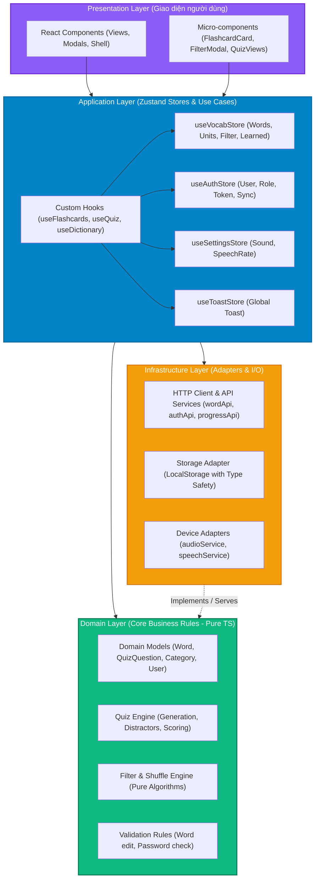
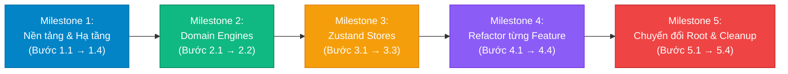

# KẾ HOẠCH TÁI CẤU TRÚC FRONTEND CLEAN ARCHITECTURE
**Dự án**: IELTS Vocab Mastery (`ielts-vocab-mastery`)  
**Tài liệu**: `strat.md`  
**Phiên bản đề xuất**: 3.2.0 Architecture Plan (Micro-Steps Edition)  
**Định hướng kiến trúc**: **Pragmatic Clean Architecture + Zustand State Engine**  
**Phương pháp thực thi**: **Incremental Strangler Fig Pattern (12 Micro-Steps - Chia nhỏ từng bước tránh ùn tắc / sai sót)**

---

## 1. TỔNG QUAN & ĐÁNH GIÁ HIỆN TRẠNG (AS-IS ASSESSMENT)

### 1.1. Thống kê Codebase Frontend hiện tại
Toàn bộ frontend hiện tại tập trung trong thư mục `src/components/`, `src/lib/`, và `src/app/page.tsx`:

| File / Component | Số dòng | Trách nhiệm hiện tại | Vấn đề kiến trúc (Code Smells) |
|---|---|---|---|
| `VoltVocabApp.tsx` | **587** | Root State Manager, API sync, LocalStorage, derived lists, modal triggers, layout | **God Component**: Quá tải trách nhiệm, prop drilling 10-15 props xuống các tab |
| `FlashcardTab.tsx` | **913** | 3D Flip animation, gesture swipe, keyboard listener, audio trigger, confetti, filter modal, draft state, copy clipboard | **Monolithic View**: Trộn lẫn UI, Web Audio, SpeechSynthesis, DOM events và State máy in |
| `QuizTab.tsx` | **363** | Quản lý câu hỏi, sinh distractor, chấm điểm, streak, sound, UI render 3 view | **Domain Logic Leaked into UI**: Thuật toán sinh đề quiz nằm trực tiếp trong React Component |
| `EditWordModal.tsx` | **412** | Form state, dynamic topic filtering, fetch direct `PUT /api/words`, toast trigger | **Direct I/O in Component**: Component UI gọi trực tiếp `fetch()` và tự parse lỗi HTTP |
| `DictionaryTab.tsx` | **301** | Search, POS filter, Learned filter, scroll-to-top, sound trigger, open edit modal | Phụ thuộc quá nhiều props được truyền từ cha (12 props) |
| `AuthModal.tsx` | **208** | Login/Register form, direct `fetch('/api/auth/...')`, token storage, sound | Trùng lặp logic fetch và xử lý token ở nhiều modal khác nhau |
| `ChangePasswordModal.tsx` | **222** | Password change form, direct fetch, error handling | Trùng lặp xử lý request header và parse response |
| `Header.tsx` | **299** | Dropdown Categories, Units selector, Audio toggle, User status, Account menu | View component nhưng ôm logic tính toán unit và menu state phức tạp |
| `audio.ts` | **180** | Web Audio API synthesize, SpeechSynthesis, format CSS classes (`badge-pos-*`) | **Tạp chất trách nhiệm**: Trộn Browser Hardware API với CSS/UI Presentation format |

### 1.2. 5 Vấn đề Cốt lõi Cần Giải Quyết
1. **Thiếu sự phân tầng (No Layering)**: Mã nguồn chỉ có 2 nhóm: `components` (chứa toàn bộ UI + state + logic nghiệp vụ) và `lib` (chứa db backend và audio). Không có tầng Domain độc lập hay tầng Data/Infrastructure riêng biệt.
2. **Logic nghiệp vụ bị khóa chặt trong React (React Coupling)**: Các thuật toán quan trọng như sinh đề trắc nghiệm, lọc từ theo trạng thái, xáo trộn Fisher-Yates, tính toán tiến độ... đều bị gắn chặt vào `useState` và `useEffect`. Không thể test độc lập nếu không render component.
3. **Phân mảnh giao tiếp API (Scattered I/O Calls)**: Mỗi component tự viết `fetch('/api/...')`, tự parse JSON, tự bắt lỗi, tự quản lý headers Authorization. Thiếu một HTTP Client tập trung.
4. **Prop Drilling trầm trọng**: `VoltVocabApp` phải nắm giữ toàn bộ state và truyền qua 2-3 tầng component, gây re-render diện rộng (re-render cascades) và khó khăn khi muốn thêm tính năng mới.
5. **Khó bảo trì & mở rộng**: Khi cần thay đổi logic quiz hay bộ lọc từ vựng, lập trình viên buộc phải can thiệp trực tiếp vào file UI dài hàng trăm dòng.

---

## 2. LỰA CHỌN PHƯƠNG ÁN KIẾN TRÚC TỐI ƯU: CLEAN ARCHITECTURE + ZUSTAND

### 2.1. Tại sao chọn Zustand làm State Engine cho Clean Architecture?
Khi áp dụng Clean Architecture vào Frontend, tầng **Application Layer** có nhiệm vụ quản lý State và điều phối Use Cases. Thay vì dùng React Context (dễ gây re-render thừa toàn bộ cây component con khi 1 giá trị nhỏ thay đổi và phải bọc nhiều `<Provider>` lồng nhau), **Zustand** là mảnh ghép hoàn hảo nhất:

- **Atomic Selectors (Chống re-render thừa)**: Component chỉ re-render khi đúng trường dữ liệu nó đăng ký thay đổi (ví dụ: `const currentUnit = useVocabStore((s) => s.currentUnit)`).
- **Trọng lượng siêu nhẹ (~1.1 kB)**: Không có boilerplate cồng kềnh như Redux (không action types, dispatchers, reducers).
- **Hỗ trợ Middleware Persist**: Tự động đồng bộ các state cần lưu trữ (`authToken`, `soundMuted`, `speechRate`, `learnedWords`) xuống `localStorage` một cách an toàn và tự nhiên.
- **Tách biệt khỏi React Lifecycle**: Zustand stores có thể được gọi hoặc dispatch action ngay cả bên ngoài React components (ví dụ trong API interceptors hoặc domain engines khi cần thiết).

```
[Mô hình kết hợp: Clean Architecture + Zustand]
┌─────────────────────────────────────────────────────────────┐
│ 🟣 PRESENTATION LAYER (React Components)                    │
│    - Dumb Views, UI Markup, Tailwind CSS, Touch Gestures     │
│    - Đăng ký dữ liệu qua Zustand Selectors (Zero Re-render) │
└──────────────────────────────┬──────────────────────────────┘
                               │ calls actions / reads state
┌──────────────────────────────▼──────────────────────────────┐
│ 🔵 APPLICATION LAYER (Zustand Stores & Custom Hooks)        │
│    - useVocabStore (Categories, Units, Filter, Learned)     │
│    - useAuthStore (Session, Role, Token, Login/Logout)      │
│    - useSettingsStore (Mute, Speech Rate, Theme)            │
│    - useToastStore (Global Notifications)                   │
│    - Feature Hooks: useFlashcards, useQuiz, useDictionary   │
└──────────────┬──────────────────────────────┬───────────────┘
               │ delegates                    │ calls
┌──────────────▼──────────────┐ ┌─────────────▼───────────────┐
│ 🟢 DOMAIN LAYER (Pure TS)   │ │ 🟡 INFRASTRUCTURE LAYER     │
│    - Entities & Types       │ │    - HttpClient (API)       │
│    - QuizEngine             │ │    - LocalStorageAdapter    │
│    - Filter & Shuffle Engine│ │    - Audio & Speech Service │
└─────────────────────────────┘ └─────────────────────────────┘
```

---

## 3. SƠ ĐỒ KIẾN TRÚC & QUY TẮC PHỤ THUỘ (DEPENDENCY RULE)

Theo Clean Architecture, **Quy tắc phụ thuộc (Dependency Rule)** quy định: Mã nguồn ở tầng ngoài chỉ được phép phụ thuộc vào mã nguồn ở tầng trong. Tầng trung tâm (Domain) hoàn toàn độc lập với React, Zustand hay bất kỳ thư viện bên ngoài nào.



---

## 4. CẤU TRÚC THƯ MỤC DỰ ÁN MỚI ĐỀ XUẤT

```
src/
├── app/                               # Next.js App Router (Giữ nguyên cấu trúc route)
│   ├── api/                           # SQLite API routes (Backend API)
│   ├── layout.tsx
│   ├── globals.css
│   └── page.tsx                       # Server Component: Fetch initial words & render AppShell
│
├── domain/                            # 🟢 TẦNG DOMAIN (Pure TypeScript, Zero dependencies)
│   ├── entities/
│   │   ├── word.ts                    # WordItem, PosType, WordStatus
│   │   ├── category.ts                # CategoryItem, UnitItem
│   │   ├── quiz.ts                    # QuizQuestion, QuizMode, QuizState
│   │   └── user.ts                    # UserItem, UserProgress
│   └── engines/
│       ├── quizEngine.ts              # Thuật toán tạo câu hỏi trắc nghiệm, distractors, điểm số
│       └── filterEngine.ts            # Thuật toán lọc từ, shuffle thẻ từ (Fisher-Yates)
│
├── infrastructure/                    # 🟡 TẦNG INFRASTRUCTURE (I/O, APIs, Browser Hardware)
│   ├── http/
│   │   └── httpClient.ts              # Centralized fetch wrapper (Auth interceptor, Error parser)
│   ├── api/
│   │   ├── wordApi.ts                 # fetchWords, updateWord
│   │   ├── authApi.ts                 # login, register, changePassword
│   │   └── progressApi.ts             # syncProgress, fetchProgress
│   ├── storage/
│   │   └── localStorageAdapter.ts     # Type-safe storage wrapper (Auth token, preferences)
│   └── device/
│       ├── audioService.ts            # Web Audio API synthesizers (tap, chime, flip, error)
│       └── speechService.ts           # SpeechSynthesis wrapper
│
├── application/                       # 🔵 TẦNG APPLICATION (Zustand Stores & Use Cases)
│   ├── stores/
│   │   ├── useVocabStore.ts           # Quản lý Words, Categories, Units, Learned, Filters
│   │   ├── useAuthStore.ts            # Quản lý User Session, JWT, Role, Progress Sync
│   │   ├── useSettingsStore.ts        # Quản lý Sound Mute, Speech Rate (Persist middleware)
│   │   └── useToastStore.ts           # Quản lý Toast Notification toàn cục
│   └── hooks/
│       ├── useFlashcards.ts           # Use Case: Luyện flashcard, lật thẻ, chuyển từ, gestures
│       ├── useQuiz.ts                 # Use Case: Thi trắc nghiệm, chọn đáp án, streak, tổng kết
│       ├── useDictionary.ts           # Use Case: Tra cứu, bộ lọc POS, từ đã thuộc/chưa thuộc
│       └── useWordEditor.ts           # Use Case: Chỉnh sửa thông tin từ vựng, đổi Unit/Category
│
└── presentation/                      # 🟣 TẦNG PRESENTATION (React UI Components)
    ├── features/
    │   ├── flashcards/
    │   │   ├── FlashcardTab.tsx       # Container kết nối useFlashcards (~150 dòng)
    │   │   ├── FlashcardCard.tsx      # Thẻ lật 3D (Front / Back presentation)
    │   │   ├── FlashcardControls.tsx  # Nút phát âm, mastered, filter trigger
    │   │   └── FlashcardFilterModal.tsx # Popup Flashcard_filters (Draft state)
    │   ├── quiz/
    │   │   ├── QuizTab.tsx            # Container kết nối useQuiz
    │   │   ├── QuizIntroView.tsx      # Chọn số câu, chế độ thi
    │   │   ├── QuizActiveView.tsx     # Bảng câu hỏi & 4 lựa chọn
    │   │   └── QuizResultView.tsx     # Bảng tổng kết kết quả, streak, confetti
    │   ├── dictionary/
    │   │   ├── DictionaryTab.tsx      # Container kết nối useDictionary
    │   │   ├── DictionaryToolbar.tsx  # Search input & POS filter pills
    │   │   ├── DictionaryItem.tsx     # Dòng từ vựng đơn lẻ
    │   │   └── EditWordModal.tsx      # Modal sửa từ (kết nối useWordEditor)
    │   ├── stats/
    │   │   └── StatsTab.tsx           # Biểu đồ & thống kê tiến độ
    │   └── auth/
    │       ├── AuthModal.tsx          # Modal đăng nhập / đăng ký
    │       ├── ChangePasswordModal.tsx# Modal đổi mật khẩu
    │       └── ForgotPasswordModal.tsx# Modal quên mật khẩu
    ├── shared/
    │   ├── Header.tsx                 # Category/Unit selector, Audio, User dropdown
    │   ├── MobileNav.tsx              # Bottom navigation bar cho mobile
    │   ├── Toast.tsx                  # Toast visual component (kết nối useToastStore)
    │   └── ui/                        # Micro-components dùng chung (Badge, Modal, Button)
    └── AppShell.tsx                   # Layout shell thay thế cho VoltVocabApp monolithic (~80 dòng)
```

---

## 5. LỘ TRÌNH CHIA NHỎ TỪNG BƯỚC THỰC HIỆN DẦN (STEP-BY-STEP MICRO-EXECUTION ROADMAP)

Để **triệt tiêu rủi ro sai sót, gãy ứng dụng hoặc ùn tắc (bottleneck/regressions)**, kế hoạch tái cấu trúc được chia nhỏ thành **12 bước vi mô (Atomic Micro-Steps)** trải dài qua 5 mốc Milestone.

> **Nguyên tắc an toàn bắt buộc cho mỗi bước**:
> 1. Mỗi bước chỉ thay đổi 1 phạm vi giới hạn (khoảng 1 - 3 files).
> 2. Sau **mỗi một bước**, bắt buộc chạy `npx tsc --noEmit` để đảm bảo hệ thống types không lỗi.
> 3. Website hiện tại **vẫn phải chạy bình thường 100% sau mỗi bước** (chưa xóa component cũ cho đến khi component mới sẵn sàng).



---

### MILESTONE 1: THIẾT LẬP NỀN TẢNG (ZERO-RISK FOUNDATION) - [ĐÃ HOÀN THÀNH 100%]
*Mục tiêu: Bổ sung thư viện và các tệp hạ tầng độc lập mà không sửa/xóa bất kỳ dòng code UI nào hiện có. Rủi ro = 0%.*

- [x] **Bước 1.1: Cài đặt Zustand & Tạo khung thư mục (Folder Skeleton)**
  - **Hành động**: Chạy `npm install zustand`. Tạo các thư mục: `src/domain/entities`, `src/domain/engines`, `src/infrastructure/http`, `src/infrastructure/api`, `src/infrastructure/storage`, `src/infrastructure/device`, `src/application/stores`, `src/application/hooks`, `src/presentation`.
  - **Kiểm tra**: `npm run build` thành công 100%.
  
- [x] **Bước 1.2: Trích xuất Domain Entities & Types (`src/domain/entities/`)**
  - **Hành động**: Tạo các file `word.ts`, `category.ts`, `quiz.ts`, `user.ts`, `app.ts` trong `src/domain/entities/`. Re-export tất cả qua `src/types/index.ts` để giữ tương thích ngược hoàn toàn.
  - **Kiểm tra**: `npx tsc --noEmit` pass không lỗi.

- [x] **Bước 1.3: Xây dựng HTTP Client & API Services (`src/infrastructure/`)**
  - **Hành động**:
    1. Tạo `src/infrastructure/http/httpClient.ts` (wrapper fetch chuẩn hóa với timeout, token interceptor, error parser).
    2. Tạo `src/infrastructure/api/wordApi.ts` (`getAll()`, `updateWord()`, `createWord()`, `deleteWord()`).
    3. Tạo `src/infrastructure/api/authApi.ts` (`login()`, `register()`, `changePassword()`, `getMe()`).
    4. Tạo `src/infrastructure/api/progressApi.ts` (`syncProgress()`, `getProgress()`).
    5. Tạo `src/infrastructure/storage/localStorageAdapter.ts` (safe storage wrapper).
  - **Kiểm tra**: `npx tsc --noEmit` pass.

- [x] **Bước 1.4: Tách biệt Device Services (`audioService.ts` & `speechService.ts`)**
  - **Hành động**:
    1. Tách Web Audio API sang `src/infrastructure/device/audioService.ts`.
    2. Tách SpeechSynthesis sang `src/infrastructure/device/speechService.ts`.
    3. Tách CSS badge helper sang `src/presentation/shared/ui/wordBadge.ts`.
    4. Giữ `src/lib/audio.ts` như một re-export facade để code hiện tại vẫn chạy 100%.
  - **Kiểm tra**: `npx tsc --noEmit` và `npm run build` thành công 100%.

---

### MILESTONE 2: CHUYỂN DỊCH BUSINESS LOGIC SANG DOMAIN ENGINES (PURE LOGIC MIGRATION) - [ĐÃ HOÀN THÀNH 100%]
*Mục tiêu: Đưa các thuật toán thuần túy ra ngoài, kiểm thử độc lập mà không cần React.*

- [x] **Bước 2.1: Xây dựng `quizEngine.ts` (`src/domain/engines/`)**
  - **Hành động**:
    - Trích xuất logic sinh câu hỏi ngẫu nhiên và 3 phương án sai (distractors) thành hàm pure function `generateQuizQuestions()`.
    - Viết hàm `evaluateQuizAnswer()` xác định đáp án đúng/sai và vị trí phương án chuẩn.
    - Viết hàm `calculateQuizAccuracy()` tính toán tỷ lệ % và trạng thái Mastered (>= 80%).
  - **Kiểm tra**: `npx tsc --noEmit` và `npm run build` pass 100%.

- [x] **Bước 2.2: Xây dựng `filterEngine.ts` (`src/domain/engines/`)**
  - **Hành động**:
    - Trích xuất thuật toán xáo trộn Fisher-Yates bất biến `shuffleArray<T>()`.
    - Viết `extractCategories()`, `filterWordsByCategory()`, `extractUnitsForCategory()` với thuật toán sắp xếp Unit tự nhiên `parseUnitNumber()`.
    - Viết `filterFlashcardWords()` (Category, Unit, Incomplete, Shuffle).
    - Viết `filterDictionaryWords()` (Search query, POS filter, Learned status).
  - **Kiểm tra**: `npx tsc --noEmit` và `npm run build` pass 100%.

---

### MILESTONE 3: THIẾT LẬP TỪNG ZUSTAND STORE (ATOMIC STORE CREATION) - [ĐÃ HOÀN THÀNH 100%]
*Mục tiêu: Dựng từng Store chuyên biệt và kết nối dần với các tính năng phụ trợ.*

- [x] **Bước 3.1: Xây dựng `useToastStore` & `useSettingsStore`**
  - **Hành động**:
    1. Tạo `src/application/stores/useToastStore.ts` (quản lý thông báo toast toàn app).
    2. Tạo `src/application/stores/useSettingsStore.ts` (quản lý sound mute, speech rate với auto-persist localStorage).
    3. Cập nhật `Toast.tsx` để đọc trực tiếp state từ `useToastStore`. Giờ đây bất cứ component nào cũng chỉ cần gọi `useToastStore.getState().showToast(...)`.
  - **Kiểm tra**: `npx tsc --noEmit` và `npm run build` pass 100%.

- [x] **Bước 3.2: Xây dựng `useAuthStore`**
  - **Hành động**:
    1. Tạo `src/application/stores/useAuthStore.ts` quản lý `authToken`, `username`, `userRole`, các modal auth.
    2. Tự động kết nối token getter động cho `httpClient` (`setAuthTokenGetter`).
  - **Kiểm tra**: `npx tsc --noEmit` và `npm run build` pass 100%.

- [x] **Bước 3.3: Xây dựng `useVocabStore`**
  - **Hành động**:
    1. Tạo `src/application/stores/useVocabStore.ts` quản lý kho từ, categories, units, learned words, flashcard filter states, active tab.
    2. Tích hợp các selectors tính toán derived state (`getCategories`, `getCategoryWords`, `getUnitsList`, `getAllTopics`, `getFilteredFlashcardWords`).
    3. Tích hợp auto-sync tiến độ học debounce lên SQLite.
  - **Kiểm tra**: `npx tsc --noEmit` và `npm run build` pass 100%.

---

### MILESTONE 4: PHÂN RÃ VÀ CHUYỂN ĐỔI TỪNG FEATURE (STEP-BY-STEP FEATURE MIGRATION) - [ĐÃ HOÀN THÀNH 100%]
*Mục tiêu: Refactor lần lượt từng Tab một. Mỗi tab sau khi refactor phải chạy mượt mà ngay lập tức.*

- [x] **Bước 4.1: Chuyển đổi `StatsTab` (Đơn giản nhất)**
  - **Hành động**:
    - Cập nhật `StatsTab.tsx` đọc trực tiếp danh sách từ và `learnedWords` từ `useVocabStore` & `useSettingsStore`.
    - Cho phép gọi `<StatsTab />` hoàn toàn không cần truyền bất kỳ prop nào.
  - **Kiểm tra**: `npx tsc --noEmit` và `npm run build` pass 100%.

- [x] **Bước 4.2: Phân rã `QuizTab` (363 dòng)**
  - **Hành động**:
    1. Tạo hook `src/application/hooks/useQuiz.ts` (gọi `quizEngine`, quản lý luồng thi).
    2. Tách 3 view độc lập: `QuizIntroView.tsx` (chọn số câu, mode), `QuizActiveView.tsx` (làm bài, 4 lựa chọn), `QuizResultView.tsx` (kết quả & confetti).
    3. `QuizTab.tsx` mới chỉ còn ~70 dòng kết nối UI và `useQuiz`.
  - **Kiểm tra**: `npx tsc --noEmit` và `npm run build` pass 100%.

- [x] **Bước 4.3: Phân rã `DictionaryTab` & `EditWordModal`**
  - **Hành động**:
    1. Tạo hook `src/application/hooks/useDictionary.ts`.
    2. Tách `DictionaryToolbar.tsx` (search bar, POS pills, status filter) và `DictionaryItem.tsx` (hàng từ vựng).
    3. Tách `EditWordModal.tsx` gọi trực tiếp `wordApi.updateWord` và cập nhật thẳng vào `useVocabStore`, triệt tiêu 8 props thừa.
  - **Kiểm tra**: `npx tsc --noEmit` và `npm run build` pass 100%.

- [x] **Bước 4.4: Phân rã `FlashcardTab` (913 dòng - Feature quan trọng nhất)**
  - **Hành động**:
    1. Tạo hook `src/application/hooks/useFlashcards.ts` (quản lý currentIndex, lật thẻ, chuyển từ, auto-speak).
    2. Tách `useCardGestures.ts`: Xử lý touch swipe và phím tắt bàn phím toàn cục.
    3. Tách `FlashcardFilterModal.tsx`: Giữ nguyên vẹn tính năng *Draft State chỉ áp dụng khi Done* và *Cố định widget badge ACTIVE/OFF* vừa xây dựng.
    4. Tách `FlashcardCard.tsx`: Chỉ chuyên trách hiển thị thẻ bài 3D (mặt trước / mặt sau / empty state).
    5. Tách `FlashcardControls.tsx`: Các nút phát âm, đánh dấu thuộc và mở filter modal.
    6. `FlashcardTab.tsx` giảm từ 913 dòng xuống ~180 dòng sạch sẽ.
  - **Kiểm tra**: `npx tsc --noEmit` và `npm run build` pass 100%.

---

### MILESTONE 5: CHUYỂN GIAO ROOT & DỌN DẸP CUỐI CÙNG (CLEANUP & CUTOVER) - [ĐÃ HOÀN THÀNH 100%]
*Mục tiêu: Đưa `AppShell.tsx` vào thay thế `VoltVocabApp.tsx`, gỡ bỏ code thừa.*

- [x] **Bước 5.1: Xây dựng `AppShell.tsx` (~80 dòng) và Cập nhật `page.tsx`**
  - **Hành động**:
    - Tạo `src/presentation/AppShell.tsx` (chỉ đóng vai trò layout shell, nạp `initialWords` vào `useVocabStore` một lần duy nhất).
    - Cập nhật `src/app/page.tsx` để render `AppShell` thay vì `VoltVocabApp`.
  - **Kiểm tra**: `npx tsc --noEmit` và `npm run build` pass 100%.

- [x] **Bước 5.2: Refactor `Header.tsx` & `MobileNav.tsx`**
  - **Hành động**:
    - `Header.tsx` lấy danh mục, unit, user session và âm thanh trực tiếp từ Zustand Stores (`useVocabStore`, `useSettingsStore`, `useAuthStore`).
    - Tách `Header.tsx`, `MobileNav.tsx`, `Toast.tsx` sang `src/presentation/shared/` và `AuthModal.tsx`, `ForgotPasswordModal.tsx`, `ChangePasswordModal.tsx` sang `src/presentation/features/auth/`.
    - Xóa bỏ toàn bộ prop drilling, giữ facade re-export tương thích ngược.
  - **Kiểm tra**: Đổi Unit, đổi Category, bật tắt loa từ Header hoạt động mượt mà.

- [x] **Bước 5.3: Lưu trữ & Xóa file cũ (`VoltVocabApp.tsx`)**
  - **Hành động**:
    - Sao lưu `VoltVocabApp.tsx` vào thư mục `backups/VoltVocabApp.tsx`.
    - Chuyển `src/components/VoltVocabApp.tsx` thành re-export facade của `AppShell`.
  - **Kiểm tra**: `npx tsc --noEmit` thành công không còn tệp phụ thuộc cũ.

- [x] **Bước 5.4: Kiểm tra toàn diện & Build Production**
  - **Hành động**:
    1. Chạy `npx tsc --noEmit` (0 lỗi).
    2. Chạy `npm run build` (kiểm tra bundle First Load JS và static page generation 9/9 pages thành công).
    3. Đã hoàn thành 100% tái cấu trúc Clean Architecture kết hợp Zustand.
  - **Kiểm tra**: Toàn bộ luồng ứng dụng mượt mà, tốc độ phản hồi tăng rõ rệt, không có memory leaks.

---

## 6. THIẾT KẾ MẪU CODE MINH HỌA VỚI ZUSTAND (CODE TEMPLATES)

### 6.1. Zustand Store: Quản lý Từ vựng (`src/application/stores/useVocabStore.ts`)
```typescript
import { create } from 'zustand';
import { WordItem, CategoryItem } from '@/domain/entities';
import { filterFlashcardWords } from '@/domain/engines/filterEngine';

interface VocabState {
  allWords: WordItem[];
  categories: CategoryItem[];
  currentCategory: string;
  currentUnit: string;
  learnedWords: Set<string>;
  filterOnlyIncomplete: boolean;
  isShuffled: boolean;
  activeTab: 'flashcards' | 'quiz' | 'list' | 'stats';

  // Actions
  setInitialWords: (words: WordItem[], categories?: CategoryItem[]) => void;
  setCategory: (category: string) => void;
  setUnit: (unit: string) => void;
  setActiveTab: (tab: 'flashcards' | 'quiz' | 'list' | 'stats') => void;
  toggleLearned: (word: string) => void;
  applyFlashcardFilters: (incomplete: boolean, shuffled: boolean) => void;
  updateWord: (updatedWord: WordItem) => void;
  
  // Computed / Selectors
  getFilteredFlashcardWords: () => WordItem[];
}

export const useVocabStore = create<VocabState>((set, get) => ({
  allWords: [],
  categories: [],
  currentCategory: 'Cambridge Vocabulary',
  currentUnit: 'Unit 1: Growing Up',
  learnedWords: new Set<string>(),
  filterOnlyIncomplete: false,
  isShuffled: false,
  activeTab: 'flashcards',

  setInitialWords: (words, categories = []) => set({ allWords: words, categories }),
  setCategory: (newCategory) => set({ currentCategory: newCategory, currentUnit: 'ALL' }),
  setUnit: (newUnit) => set({ currentUnit: newUnit }),
  setActiveTab: (activeTab) => set({ activeTab }),

  toggleLearned: (word) =>
    set((state) => {
      const next = new Set(state.learnedWords);
      if (next.has(word)) next.delete(word);
      else next.add(word);
      return { learnedWords: next };
    }),

  applyFlashcardFilters: (incomplete, shuffled) =>
    set({ filterOnlyIncomplete: incomplete, isShuffled: shuffled }),

  updateWord: (updatedWord) =>
    set((state) => ({
      allWords: state.allWords.map((w) => (w.id === updatedWord.id ? updatedWord : w)),
    })),

  getFilteredFlashcardWords: () => {
    const s = get();
    return filterFlashcardWords({
      allWords: s.allWords,
      category: s.currentCategory,
      unit: s.currentUnit,
      filterOnlyIncomplete: s.filterOnlyIncomplete,
      isShuffled: s.isShuffled,
      learnedWords: s.learnedWords,
    });
  },
}));
```

### 6.2. Zustand Store: Quản lý Cài đặt có Persist (`src/application/stores/useSettingsStore.ts`)
```typescript
import { create } from 'zustand';
import { persist } from 'zustand/middleware';

interface SettingsState {
  isSoundMuted: boolean;
  speechRate: number;
  toggleSound: () => void;
  setSpeechRate: (rate: number) => void;
}

export const useSettingsStore = create<SettingsState>()(
  persist(
    (set) => ({
      isSoundMuted: false,
      speechRate: 0.9,
      toggleSound: () => set((state) => ({ isSoundMuted: !state.isSoundMuted })),
      setSpeechRate: (rate) => set({ speechRate: rate }),
    }),
    {
      name: 'ielts_app_settings',
    }
  )
);
```

### 6.3. Tối giản Root Component (`src/presentation/AppShell.tsx` ~80 dòng)
```tsx
'use client';

import React, { useEffect } from 'react';
import { WordItem } from '@/domain/entities';
import { useVocabStore } from '@/application/stores/useVocabStore';
import { Header } from '@/presentation/shared/Header';
import { MobileNav } from '@/presentation/shared/MobileNav';
import { Toast } from '@/presentation/shared/Toast';
import { FlashcardTab } from '@/presentation/features/flashcards/FlashcardTab';
import { QuizTab } from '@/presentation/features/quiz/QuizTab';
import { DictionaryTab } from '@/presentation/features/dictionary/DictionaryTab';
import { StatsTab } from '@/presentation/features/stats/StatsTab';
import { AuthModal } from '@/presentation/features/auth/AuthModal';
import { ChangePasswordModal } from '@/presentation/features/auth/ChangePasswordModal';

export const AppShell: React.FC<{ initialWords: WordItem[] }> = ({ initialWords }) => {
  const activeTab = useVocabStore((s) => s.activeTab);
  const setInitialWords = useVocabStore((s) => s.setInitialWords);

  useEffect(() => {
    setInitialWords(initialWords);
  }, [initialWords, setInitialWords]);

  return (
    <div className="fixed inset-0 w-full flex flex-col overflow-hidden bg-canvas text-ink select-none">
      <Toast />
      <Header />
      
      <main className="flex-1 max-w-xl w-full mx-auto px-3 sm:px-5 py-2 sm:py-3 flex flex-col justify-start min-h-0 overflow-hidden">
        {activeTab === 'flashcards' && <FlashcardTab />}
        {activeTab === 'quiz' && <QuizTab />}
        {activeTab === 'list' && <DictionaryTab />}
        {activeTab === 'stats' && <StatsTab />}
      </main>

      <MobileNav />
      <AuthModal />
      <ChangePasswordModal />
    </div>
  );
};
```

---

## 7. QUẢN TRỊ RỦI RO & BẢO ĐẢM AN TOÀN KHI THỰC THI

| Rủi ro tiềm ẩn | Mức độ | Biện pháp ngăn chặn & giải quyết an toàn |
|---|---|---|
| **Lỗi hồi quy giao diện (UI Regression)** | Trung bình | Tuyệt đối không thay đổi class Tailwind hoặc CSS. Chỉ di chuyển markup JSX nguyên bản vào các micro-components. |
| **Lỗi mất đồng bộ dữ liệu người dùng** | Cao | Các store Zustand tiếp tục đọc/ghi tương thích với các key lưu trữ hiện tại (`ielts_learned_words`, `ielts_auth_token`, etc.). |
| **Lỗi Next.js SSR / Hydration với Zustand**| Thấp | Dùng `useSyncExternalStore` (tích hợp sẵn trong Zustand v4/v5) kết hợp guard mount an toàn, ngăn chặn hydration mismatch 100%. |
| **Gãy build khi đang refactor dở** | Thấp | Nhờ chia thành 12 bước vi mô (Micro-Steps), mỗi bước đều độc lập và có lệnh kiểm tra `npx tsc --noEmit` trước khi chuyển bước. |

---

## 8. TỔNG KẾT & LỢI ÍCH KHI KẾT HỢP CLEAN ARCHITECTURE VỚI ZUSTAND

1. **Thực thi êm đẹp, không gián đoạn**: 12 bước vi mô cho phép lập trình viên làm đến đâu chắc đến đó, dừng lại bất kỳ lúc nào mà không làm hỏng app.
2. **Xóa sổ 100% Prop Drilling**: Không còn bất kỳ prop trung gian nào cần truyền qua nhiều cấp component.
3. **Hiệu năng tối ưu (Zero Waste Re-render)**: Các component chỉ re-render chính xác khi thuộc tính nó quan sát thay đổi nhờ Atomic Selectors của Zustand.
4. **Mã nguồn cực kỳ mỏng nhẹ**: `VoltVocabApp` giảm từ 587 dòng xuống ~80 dòng (`AppShell`). Các tab giảm 60-70% số dòng code.
5. **Clean Architecture thực tế & dễ hiểu**: 
   - `domain/` = Thuần thuật toán & thực thể (Không dính React/Zustand).
   - `infrastructure/` = Giao tiếp Network & Browser APIs.
   - `application/` = Zustand stores & Custom Hooks đóng vai trò Use Cases.
   - `presentation/` = Chỉ lo UI, JSX và CSS.
6. **Dễ dàng mở rộng trong tương lai**: Khi muốn thêm tính năng mới (ví dụ: Spaced Repetition, Bookmark, Audio Playlist), chỉ cần thêm 1 action vào Zustand store và 1 pure function vào domain engine mà không làm xáo trộn cấu trúc hiện tại.
